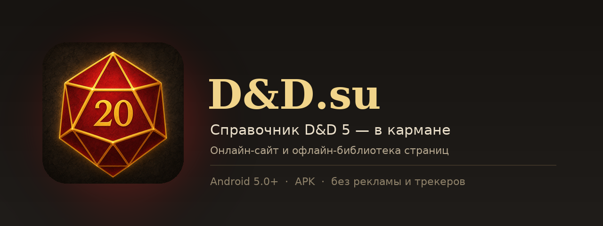

# D&D.su для Android

**Неофициальный мобильный клиент справочника D&D 5 на русском языке** — сайт [dnd.su](https://dnd.su) в нативном приложении плюс офлайн-библиотека сохранённых страниц.



---

## Скачать APK

| Способ | Ссылка |
|---|---|
| **Готовый файл в репозитории** | [`release/dndsu-reader-1.0.apk`](release/dndsu-reader-1.0.apk) |
| Свежая сборка GitHub Actions | вкладка **Actions** → последний запуск → *Artifacts* → `dndsu-reader-apk` |
| Последний релиз | раздел **Releases** → `latest` |

Установка: скачайте APK на телефон, откройте файл и разрешите установку из этого источника
(«Настройки → Безопасность → Установка неизвестных приложений»). Требуется **Android 5.0+**
(минимальная версия — 21, целевая — 34).

Подпись APK (SHA-256 сертификата):

```
bbcef9c70705ed391521cce0a68e6047d32dee6ae9f12b111365b76be9667b10
```

---

## Возможности

**Сайт в приложении**
* Полноценный просмотр [dnd.su](https://dnd.su) и [next.dnd.su](https://next.dnd.su) (D&D 2024) во встроенном WebView.
* Нижняя навигация: Главная · Бестиарий · Заклинания · Предметы · Офлайн-библиотека.
* Меню со всеми разделами: классы, расы, черты, предыстории, статьи, версия правил 2024.
* Внешние ссылки (VK, Boosty, Chrome Web Store и т. п.) открываются в браузере, а не «уводят» приложение.
* Вход на сайт, фильтры, поиск — работают как в браузере (cookie и DOM Storage включены).

**Сохранение страниц (офлайн)**
* Кнопка-закладка в верхней панели сохраняет **текущую страницу целиком**: HTML, стили и изображения
  встраиваются в файл, поэтому страница открывается без интернета.
* **Скачивание целых разделов**: меню → «Скачать раздел» → выбрать раздел и количество страниц
  (10/20/30/50/100). Приложение само собирает ссылки на карточки раздела и сохраняет их.
* Повторная синхронизация раздела **докачивает новые страницы**, уже сохранённые не дублируются.
* «Офлайн-библиотека»: список сохранённого с поиском, размером, датой, удалением и переходом к странице.
* Ссылки между сохранёнными страницами автоматически ведут на локальные копии.

**Чтение**
* **Режим чтения** — убирает меню, баннеры и лишние блоки, оставляя текст статьи.
* **Ночной режим страниц** (экспериментальный) — затемняет оформление сайта.
* Тёмная/светлая тема приложения, размер текста (80–160 %), тёмная тема для режима чтения.

**Приватность**
* Нет рекламы, аналитики и трекеров.
* Нет разрешений на геолокацию, камеру, контакты и доступ к файлам — только интернет
  и проверка состояния сети.
* Сохранённые страницы лежат во внутреннем хранилище приложения и удаляются вместе с ним.

---

## Как пользоваться офлайном

1. Откройте нужную страницу (например, заклинание или монстра).
2. Нажмите **иконку закладки** вверху — страница сохранится вместе с картинками
   (иконка станет золотой).
3. Чтобы скачать раздел целиком: **меню (☰) → «Скачать раздел…»** → выберите раздел
   и число страниц.
4. Без интернета открывайте вкладку **«Офлайн»** — там все сохранённые материалы.

> Сохранённые страницы — это статичные снимки. Интерактивные фильтры, комментарии и формы
> на них не работают; для них нужен интернет. Вход в аккаунт на сайте также требует сети.

---

## Сборка

### Автоматически (GitHub Actions)

Workflow [`.github/workflows/android.yml`](.github/workflows/android.yml) собирает подписанный APK
на каждый push и прикрепляет его к артефактам, а также обновляет релиз `latest`.
Сборка идёт без Gradle — напрямую через `aapt2`, `javac`/`ecj`, `d8` и `apksigner`
из Android SDK на раннере.

### Локально

Нужен JDK 17+ и `python3`. Android SDK **не обязателен** — если его нет, скрипт скачает
портативные `aapt2`, `d8`, `apksigner` и `android.jar` в `.tools/`.

```bash
export JAVA_HOME=/path/to/jdk-17
bash scripts/build_apk.sh
# → release/dndsu-reader-1.0.apk
```

Параметры сборки (переменные окружения): `VERSION_NAME`, `VERSION_CODE`, `OUT`,
`ANDROID_HOME`, `KEYSTORE`, `KS_PASS`, `KEY_ALIAS`, `MIN_SDK`, `TARGET_SDK`.

### Структура проекта

```
android/app/src/main/
├── AndroidManifest.xml
├── assets/js/              JS-сниппеты: встраивание ресурсов, сохранение, режим чтения…
├── java/su/dnd/reader/     исходники (без сторонних библиотек)
│   ├── MainActivity.java   WebView, навигация, сохранение текущей страницы
│   ├── Downloader.java     фоновая загрузка разделов через скрытый WebView
│   ├── Archive.java        хранилище страниц и индекс библиотеки
│   ├── PageSaver.java      конвейер «страница → автономный HTML»
│   ├── LibraryActivity.java, SettingsActivity.java, SyncUi.java …
├── res/                    темы, иконки (vector), разметка
└── icon-source/icon.png    исходник иконки (scripts/make_icons.py генерирует mipmap-*)

scripts/
├── build_apk.sh            полный цикл сборки APK
├── fetch_tools.sh          загрузка портативных build-tools (если нет Android SDK)
├── pack_apk.py             упаковка classes.dex и выравнивание ZIP
└── make_icons.py           генерация иконок всех плотностей из icon.png
```

Приложение намеренно **не использует AndroidX/Gradle**: это даёт APK меньше 1 МБ,
мгновенную сборку и минимум зависимостей.

---

## Подпись и обновления

* APK подписан ключом `android/keystore/release.p12` (alias `dndsu`, пароль `dndsu2024`),
  который лежит в репозитории для воспроизводимых сборок.
* Благодаря этому обновления из Actions устанавливаются поверх уже установленной версии.
* ⚠️ Для публикации в магазине или широкого распространения замените ключ на собственный
  закрытый: любой, у кого есть этот файл, может подписать «обновление» от имени приложения.

## Ограничения

* Нет push-уведомлений, виджетов и синхронизации между устройствами.
* Офлайн-копии не содержат интерактивных элементов сайта.
* Некоторые страницы (генераторы, листы персонажей, «Бастионы») требуют интернета.
* Скачивание раздела идёт, пока приложение открыто; прогресс показывается в диалоге.

## Правовая информация

Приложение **неофициальное** и не связано с командой dnd.su, Wizards of the Coast
или Hasbro. Весь контент справочника принадлежит его авторам и правообладателям;
приложение лишь отображает публичные страницы сайта и позволяет сохранять их для
личного офлайн-чтения. Поддержите проект на [Boosty](https://boosty.to/dnd.su).

Dungeons & Dragons и D&D являются товарными знаками Wizards of the Coast.

## Лицензия

Код приложения распространяется по лицензии MIT. Тексты, изображения и оформление
сайта dnd.su под эту лицензию **не подпадают**.
